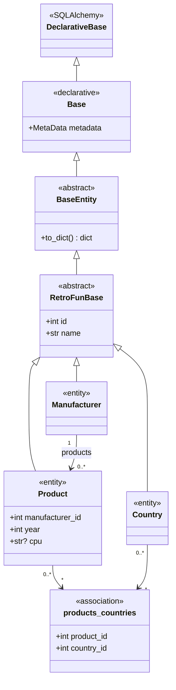

# Models

## Architecture Summary

This document defines the domain model for the RetroFun project. It follows a **code-first SQLAlchemy 2.0** architecture where Python classes are the single source of truth, and the PostgreSQL schema is a derived artifact managed via Alembic.

### Core Principles

* **Layered Bases:** Infrastructure (`retrofun.db`) provides the declarative machinery, metadata configuration, and serialization (`to_dict`); Domain (`retrofun.models`) defines the business entities.
* **Generic Identity:** The base hierarchy (`RetroFunBase`, `NamedRetroFunBase`) uses PEP 695 type parameters to support both `int` and `UUID` primary keys without boilerplate.
* **Deterministic Schema:** All DDL is qualified to the `retrofun` schema with deterministic constraint naming (`pk_`, `fk_`, `ix_`) to ensure stable Alembic autogeneration.

### Current Entities & Relationships

* **`Manufacturer`** (1) ── (0..*) **`Product`**: One-to-many relationship.
* **`Product`** (*) ── (*) **`Country`**: Many-to-many relationship via the `products_countries` association table.

The ORM models are the **source of truth** for the database schema. PostgreSQL is a derived artifact: `Base.metadata.create_all()` emits DDL from these classes, and Alembic compares migrations against `Base.metadata`.

```text
Python class → Table object → CREATE TABLE DDL → PostgreSQL
```

Never edit the database by hand and expect the models to follow.

## Class diagram



`?` marks a nullable column. Inherited members are not repeated on subclasses.

## Layer responsibilities

| Layer | Module | Responsibility |
| --- | --- | --- |
| `DeclarativeBase` | SQLAlchemy | Provides the declarative machinery |
| `Base` | `retrofun.db.base` | Owns `MetaData`: schema + constraint naming convention |
| `BaseEntity` | `retrofun.db.base` | Abstract. Adds `to_dict()` serialization |
| `RetroFunBase` | `retrofun.models.base` | Abstract. Domain base. Shared `id` + `name`, JSON `__repr__` |
| `Manufacturer` | `retrofun.models.manufacturer` | Concrete entity → `retrofun.manufacturers` |
| `Country` | `retrofun.models.country` | Concrete entity → `retrofun.countries` |
| `Product` | `retrofun.models.product` | Concrete entity → `retrofun.products` |
| `products_countries` | `retrofun.models.product_country` | Association table for Product ↔ Country M2M |

## Entities

### Product

Table `retrofun.products` · seeded from `raw_data/products.csv` (149 rows).

| Column | Python annotation | PostgreSQL | Nullable | Index / constraint |
| --- | --- | --- | --- | --- |
| `id` | `Mapped[int]` | `integer` | no | PK `pk_products`, sequence `products_id_seq` |
| `name` | `Mapped[str]` | `varchar(64)` | no | **UNIQUE** index `ix_retrofun_products_name` |
| `manufacturer_id` | `Mapped[int]` | `integer` | no | FK → `manufacturers(id)`, index `ix_retrofun_products_manufacturer_id` |
| `year` | `Mapped[int]` | `integer` | no | index `ix_retrofun_products_year` |
| `cpu` | `Mapped[str \| None]` | `varchar(32)` | yes | — |

*Note: `country` was removed during normalization. See `products_countries` below.*

### Manufacturer

Table `retrofun.manufacturers`.

| Column | Python annotation | PostgreSQL | Nullable | Index / constraint |
| --- | --- | --- | --- | --- |
| `id` | `Mapped[int]` | `integer` | no | PK `pk_manufacturers`, sequence `manufacturers_id_seq` |
| `name` | `Mapped[str]` | `varchar(64)` | no | **UNIQUE** index `ix_retrofun_manufacturers_name` |

Manufacturer names were previously duplicated across every product row. Extracting
them removes that redundancy and makes a rename a single-row update.

### Country

Table `retrofun.countries`.

| Column | Python annotation | PostgreSQL | Nullable | Index / constraint |
| --- | --- | --- | --- | --- |
| `id` | `Mapped[int]` | `integer` | no | PK `pk_countries`, sequence `countries_id_seq` |
| `name` | `Mapped[str]` | `varchar(64)` | no | **UNIQUE** index `ix_retrofun_countries_name` |

Countries are extracted from the CSV's `country` column (split by `/` for joint production).

### products_countries (Association Table)

Table `retrofun.products_countries`. Implements the Many-to-Many relationship between `Product` and `Country`.

| Column | Python annotation | PostgreSQL | Nullable | Index / constraint |
| --- | --- | --- | --- | --- |
| `product_id` | `Mapped[int]` | `integer` | no | PK, FK → `products(id)` |
| `country_id` | `Mapped[int]` | `integer` | no | PK, FK → `countries(id)` |

Composite Primary Key: `pk_products_countries` (`product_id`, `country_id`).

## Relationships

### One-to-Many: Manufacturer ↔ Product

`Manufacturer` 1 ── 0..* `Product`

* FK: `fk_products_manufacturer_id_manufacturers`
* `ON DELETE` is **not specified** → PostgreSQL default `NO ACTION`. Deleting a
  manufacturer that still has products raises `IntegrityError`. This is aggregation,
  not composition: products are not owned by their manufacturer.

### Many-to-Many: Product ↔ Country

`Product` *──* `Country` via `products_countries`

* Implemented using `secondary=ProductCountry` in the `relationship()` definition.
* `back_populates` is set on both sides (`Product.countries` and `Country.products`).
* `ON DELETE` is **not specified** → default `NO ACTION`.

## Conventions

**Schema.** `Base.metadata` is built with `schema=settings.postgres_schema` (default
`retrofun`), so DDL is schema-qualified (`CREATE TABLE retrofun.products`) regardless of
the connecting role's `search_path`. `settings.version_table_schema` ensures Alembic's
`alembic_version` table also lands in the `retrofun` schema.

**Constraint names.** Deterministic names keep Alembic autogenerate stable:

| Key | Pattern | Example |
| --- | --- | --- |
| `ix` | `ix_%(column_0_label)s` | `ix_retrofun_products_name` |
| `uq` | `uq_%(table_name)s_%(column_0_name)s` | `uq_products_name` |
| `ck` | `ck_%(table_name)s_%(constraint_name)s` | — |
| `fk` | `fk_%(table_name)s_%(column_0_name)s_%(referred_table_name)s` | `fk_products_manufacturer_id_manufacturers` |
| `pk` | `pk_%(table_name)s` | `pk_products` |

## Session semantics

`SessionLocal = sessionmaker(bind=engine, expire_on_commit=False)`.

* Objects stay readable **after** the session closes — no `DetachedInstanceError` when
  returning them from a function or serializing to JSON.
* No refresh `SELECT` after every commit.
* Trade-off: columns populated by `server_default` are **not** loaded after commit; call
  `session.refresh(obj)` when you need them.
* Relationship lazy-loads still fail on detached instances — eager-load inside the
  session.

`BaseEntity.to_dict()` returns `dict[str, Any]`, normalizing `UUID` and `datetime` to
strings. On a transient instance (before flush) `id` is `None`:

```python
c64 = Product(name="Commodore 64", manufacturer_id=1)
c64.to_dict()  # {'id': None, 'name': 'Commodore 64', ..., 'year': None, ...}
```

SQLAlchemy does not enforce NOT NULL at construction — only at flush.

## Data Type Guidance

### 🔀 `default=` vs `server_default=` — not the same thing

| Keyword | Where applied | Persists in migration? | Fires on ORM INSERT? | Fires on raw INSERT? |
| --- | --- | --- | --- | --- |
| `default=` | Python-side, SQLAlchemy ORM | ❌ No | ✅ Yes | ❌ No |
| `server_default=` | DB-side, DDL `DEFAULT` | ✅ Yes | ✅ Yes (via DB) | ✅ Yes |
| `onupdate=` | Python-side, SQLAlchemy ORM | ❌ No | ✅ Yes | ❌ No |

If your model has `default=X` but your migration has `server_default=X`, **`alembic check` reports drift** and CI's `migrate-check` job fails. If you need both ORM-side and DB-side behavior, use both keywords — they compose.

**Example: Timestamps**
For `created_at` fields, prefer `server_default=func.now()`. This ensures the timestamp is set by the database server (avoiding clock skew) and is available even if rows are inserted via raw SQL or external tools.

## Regenerate and verify

`pyreverse` ships with pylint (dev dependency):

```bash
uv run pyreverse -o mmd -p retrofun src/retrofun
```

Writes `classes_retrofun.mmd` and `packages_retrofun.mmd`. Compare against the
hand-maintained diagram above and keep whichever stays accurate.

```bash
uv run alembic upgrade head   # Apply migrations
uv run python -m retrofun.import_products   # Load CSV data
uv run python -m retrofun.main              # Query playground
```

```sql
\d+ retrofun.products
\d+ retrofun.manufacturers
\d+ retrofun.countries
\d+ retrofun.products_countries

SELECT conname, contype FROM pg_constraint
WHERE conrelid = 'retrofun.products'::regclass;

SELECT count(*) FROM retrofun.products;       -- expect 149
SELECT count(*) FROM retrofun.manufacturers;
SELECT count(*) FROM retrofun.countries;
SELECT count(*) FROM retrofun.products_countries;
```

The diagram is the *design*; the database is the *reality*. Compare when they might
have drifted.

## Open items

* `BaseEntity.to_dict()` lives in `db/` but is a domain concern — consider moving it
  to `models/base.py` once the layer above earns responsibility.
