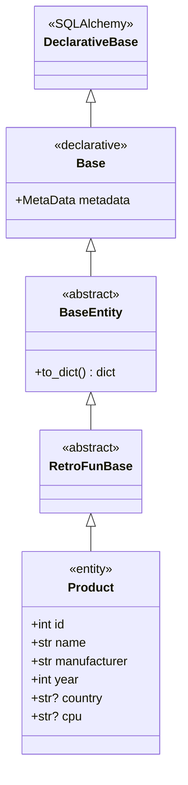
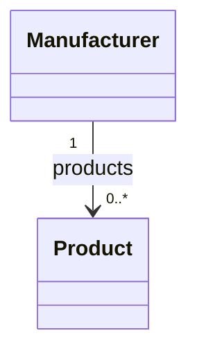

# Models

The ORM models are the **source of truth** for the database schema. PostgreSQL is a
derived artifact: `Base.metadata.create_all()` emits DDL from these classes, and
Alembic (planned) will compare migrations against `Base.metadata`.

```md
Python class → Table object → CREATE TABLE DDL → PostgreSQL
```

Never edit the database by hand and expect the models to follow.

## Class diagram



`?` marks a nullable column. Inherited members are not repeated on subclasses.

## Layer responsibilities

| Layer | Module | Responsibility |
| --- | --- | --- |
| `DeclarativeBase` | SQLAlchemy | Provides the declarative machinery |
| `Base` | `retrofun.db.base` | Owns `MetaData`: schema + constraint naming convention |
| `BaseEntity` | `retrofun.db.base` | Abstract. Adds `to_dict()` serialization |
| `RetroFunBase` | `retrofun.models.base` | Abstract. Domain base — currently empty (see Open items) |
| `Product` | `retrofun.models.product` | Concrete entity → `retrofun.products` |

Only `Product` produces a table. `BaseEntity` and `RetroFunBase` set
`__abstract__ = True`, so SQLAlchemy skips table creation for them.

## Product

Table `retrofun.products` · seeded from `raw_data/products.csv` (149 rows).

| Column | PostgreSQL | Nullable | Index / constraint |
| --- | --- | --- | --- |
| `id` | `integer` | no | PK `pk_products`, sequence `products_id_seq` |
| `name` | `varchar(64)` | no | **UNIQUE** index `ix_retrofun_products_name` |
| `manufacturer_id` | `integer` | no | FK → `manufacturers(id)`, index `ix_retrofun_products_manufacturer_id` |
| `year` | `integer` | no | index `ix_retrofun_products_year` |
| `country` | `varchar(32)` | yes | — |
| `cpu` | `varchar(32)` | yes | — |

## Manufacturer

Table `retrofun.manufacturers`.

| Column | PostgreSQL | Nullable | Index / constraint |
| --- | --- | --- | --- |
| `id` | `integer` | no | PK `pk_manufacturers`, sequence `manufacturers_id_seq` |
| `name` | `varchar(64)` | no | **UNIQUE** index `ix_retrofun_manufacturers_name` |

Manufacturer names were previously duplicated across every product row. Extracting
them removes that redundancy and makes a rename a single-row update.

## Relationships

`Manufacturer` 1 ── 0..* `Product`



- FK: `fk_products_manufacturer_id_manufacturers`
- `ON DELETE` is **not specified** → PostgreSQL default `NO ACTION`. Deleting a
  manufacturer that still has products raises `IntegrityError`. This is aggregation,
  not composition: products are not owned by their manufacturer.
- Changing this to `ON DELETE CASCADE` would make it composition and delete products
  silently. Decide deliberately; do not let it happen by accident.
- Manufacturer ids follow first appearance in `raw_data/products.csv`, because the
  importer resolves each name to a row as it reads.

### Unique index, not unique constraint

`name` is declared `mapped_column(String(64), index=True, unique=True)`. Because
`index=True` is present, `unique=True` becomes a flag on the **index** rather than a
table-level `UniqueConstraint`. Consequences:

- `psql` shows `UNIQUE, btree (name)` — not `UNIQUE CONSTRAINT, btree (name)`
- `pg_constraint` has no `u` entry for this table
- the `"uq"` naming convention never fires; the `"ix"` convention names it
- `ON CONFLICT (name)` works; `ON CONFLICT ON CONSTRAINT ...` does not
- the index cannot be `DEFERRABLE`

Enforcement is identical either way — PostgreSQL implements unique constraints with
unique indexes.

## How a model becomes a table

Defining `class Product(RetroFunBase)` triggers SQLAlchemy's declarative hook, which
reads `__tablename__`, collects the `Mapped[...]` columns, builds a `Table`, and
**registers it into `Base.metadata.tables`**.

**The import is the registration.** Any script calling `create_all()` must import the
models package, or metadata is empty and nothing gets created — silently:

```python
from retrofun.db import Base, engine
from retrofun.models import Product  # noqa: F401 — load-bearing: registers the table
```

Verify:

```bash
uv run python -c "
from retrofun.db import Base
print('before:', list(Base.metadata.tables))
from retrofun.models import Product
print('after: ', list(Base.metadata.tables))
"
```

## Conventions

**Schema.** `Base.metadata` is built with `schema=settings.postgres_schema` (default
`retrofun`), so DDL is schema-qualified (`CREATE TABLE retrofun.products`) regardless of
the connecting role's `search_path`. `settings.version_table_schema` is staged for
Alembic's `alembic_version` table.

**Constraint names.** Deterministic names keep Alembic autogenerate stable:

| Key | Pattern | Example |
| --- | --- | --- |
| `ix` | `ix_%(column_0_label)s` | `ix_retrofun_products_name` |
| `uq` | `uq_%(table_name)s_%(column_0_name)s` | `uq_products_name` |
| `ck` | `ck_%(table_name)s_%(constraint_name)s` | — |
| `fk` | `fk_%(table_name)s_%(column_0_name)s_%(referred_table_name)s` | `fk_products_manufacturer_id_manufacturers` |
| `pk` | `pk_%(table_name)s` | `pk_products` |

## Session semantics

`SessionLocal = sessionmaker(bind=engine, expire_on_commit=False)`.

- Objects stay readable **after** the session closes — no `DetachedInstanceError` when
  returning them from a function or serializing to JSON.
- No refresh `SELECT` after every commit.
- Trade-off: columns populated by `server_default` are **not** loaded after commit; call
  `session.refresh(obj)` when you need them.
- Relationship lazy-loads still fail on detached instances — eager-load inside the
  session.

`BaseEntity.to_dict()` returns `dict[str, Any]`, normalizing `UUID` and `datetime` to
strings. On a transient instance (before flush) `id` is `None`:

```python
c64 = Product(name="Commodore 64", manufacturer="Commodore")
c64.to_dict()  # {'id': None, 'name': 'Commodore 64', ..., 'year': None, ...}
```

SQLAlchemy does not enforce NOT NULL at construction — only at flush.

## Regenerate and verify

`pyreverse` ships with pylint (dev dependency):

```bash
uv run pyreverse -o mmd -p retrofun src/retrofun
```

Writes `classes_retrofun.mmd` and `packages_retrofun.mmd`. Compare against the hand-maintained diagram above and keep whichever stays accurate. The generated diagram inventories project classes; the hand-written one above adds the external SQLAlchemy root and association multiplicity that pyreverse cannot infer.

```bash
uv run python -m retrofun.import_products   # DESTRUCTIVE: drop_all + create_all + load
uv run python -m retrofun.main              # query playground
```

```sql
\d+ retrofun.products
\d+ retrofun.manufacturer

SELECT conname, contype FROM pg_constraint
WHERE conrelid = 'retrofun.products'::regclass;

SELECT count(*) FROM retrofun.products;       -- expect 149
SELECT count(*) FROM retrofun.manufacturers;
SELECT count(*) FROM retrofun.products p
  LEFT JOIN retrofun.manufacturers m ON m.id = p.manufacturer_id
WHERE m.id IS NULL;                           -- expect 0 orphans
```

The diagram is the *design*; the database is the *reality*. Compare when they might
have drifted.

## Open items

- **`RetroFunBase` is an empty layer.** Give it a job (shared `id`, `created_at` /
  `updated_at`) or collapse it into `BaseEntity`.
- **`BaseEntity.to_dict()` lives in `db/`** but is a domain concern — consider moving it
  to `models/base.py` once the layer above earns responsibility.
- **No migrations.** `import_products.py` calls `drop_all` then `create_all`, destroying
  data on every run. Alembic is the exit ramp; `version_table_schema` is already staged.
